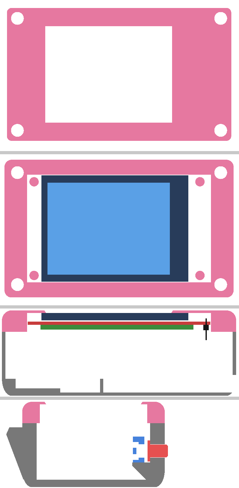
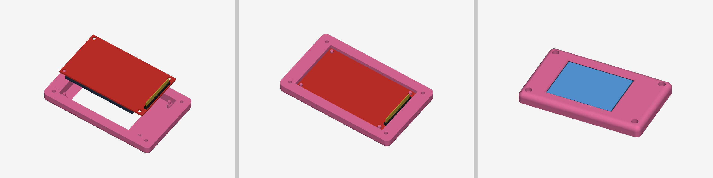

# Remote Display (ESP32 + Telegram)

Un écran 2.8" connecté à internet. Tu envoies une **photo** ou un **texte** à un bot Telegram, de n'importe où, et ça s'affiche sur l'écran.

- Les photos sont réduites et centrées automatiquement. La légende s'affiche en bas.
- La taille du texte s'ajuste toute seule. Les accents et les emojis cœur sont supportés.
- Le dernier message est sauvegardé dans la mémoire flash, donc il revient après une panne de courant.
- Le WiFi se configure avec un téléphone, sans reprogrammer l'ESP32.
- Seul le propriétaire du bot peut envoyer des messages. Les autres sont ignorés.

## Comment ça marche

```
Téléphone (app Telegram)  ──>  serveurs de Telegram  <──  ESP32 (demande les nouveaux messages)  ──>  écran
```

L'ESP32 interroge l'API de Telegram en continu (*long polling*). Quand un message arrive, il télécharge la photo en JPEG, la décode et l'affiche. Aucun serveur à héberger : Telegram sert d'intermédiaire.

## Matériel

| Composant | Détails |
|---|---|
| Microcontrôleur | ESP32-DevKitC (ESP32-WROOM-32) |
| Écran | TFT 2.8" 240x320, contrôleur **ILI9341**, SPI, 14 pins (avec tactile XPT2046) |

## Branchement

Le schéma complet est dans [`hardware/`](hardware/) (KiCad 10) ou en PDF dans [`docs/schema.pdf`](docs/schema.pdf).

| Pin écran | Fonction | ESP32 |
|---|---|---|
| 1 | VCC | 3V3 |
| 2 | GND | GND |
| 3 | CS | GPIO 5 |
| 4 | RESET | GPIO 17 |
| 5 | DC | GPIO 16 |
| 6 | SDI (MOSI) | GPIO 23 |
| 7 | SCK | GPIO 18 |
| 8 | LED (rétroéclairage) | 3V3 |
| 9 | SDO (MISO) | GPIO 19 |
| 10 | T_CLK | GPIO 18 (partagé avec SCK) |
| 11 | T_CS | GPIO 21 |
| 12 | T_DIN | GPIO 23 (partagé avec MOSI) |
| 13 | T_DO | GPIO 19 (partagé avec MISO) |
| 14 | T_IRQ | GPIO 34 |

## Installation

### 1. Créer le bot Telegram
1. Dans Telegram, ouvre une conversation avec **@BotFather**.
2. Envoie `/newbot`, puis choisis un nom et un nom d'utilisateur (qui finit par `bot`).
3. BotFather te donne un **token** qui ressemble à `123456789:ABCdef...`. Garde-le secret : quelqu'un qui a ce token peut contrôler ton bot.

### 2. Configurer le code
1. Copie `firmware/remotedisplay/secrets.example.h` en `secrets.h` dans le même dossier.
2. Mets ton token dans `BOT_TOKEN`. Laisse `OWNER_ID` à `0` pour l'instant.

`secrets.h` est dans le `.gitignore`, donc ton token se ramasse pas sur GitHub.

### 3. Librairies (Arduino IDE → Library Manager)
- Adafruit ILI9341
- Adafruit GFX Library
- ArduinoJson (v7)
- TJpg_Decoder
- WiFiManager (par tzapu)

### 4. Téléverser
Dans l'Arduino IDE :
- **Board** : ESP32 Dev Module
- **Partition Scheme** : *No OTA (2MB APP/2MB SPIFFS)*. Avec le schéma par défaut, le programme prend 94 % de la place, ce qui laisse presque rien pour ajouter des fonctions.

### 5. Premier démarrage
1. **WiFi** : l'écran affiche *Configuration WiFi*. Sur ton téléphone, connecte-toi au WiFi `Ecran-Config`. Une page s'ouvre : choisis ton WiFi et entre le mot de passe. L'ESP32 s'en souvient ensuite.
2. **Ton ID** : envoie n'importe quel message à ton bot. Il te répond ton ID Telegram.
3. Mets cet ID dans `OWNER_ID` dans `secrets.h`, puis re-téléverse.

C'est prêt! Le WiFi est déjà sauvegardé, pas besoin de le reconfigurer.

## Utilisation

| Tu envoies au bot | Résultat |
|---|---|
| Une photo | Affichée sur l'écran (avec la légende, s'il y en a une) |
| Un texte | Affiché en gros, centré |
| `/effacer` | L'écran revient à l'écran d'attente |
| `/aide` | Le bot explique comment l'utiliser |

Le bot répond « ✅ Affiché! » quand c'est fait.

Si l'écran est déménagé ailleurs, il crée tout seul le réseau `Ecran-Config` quand il trouve pas son WiFi. Il suffit de refaire l'étape 1 du premier démarrage.

## Boîtier

Le boîtier imprimé en 3D est basé sur le modèle **[Display for ESP32 with ILI9341](https://www.printables.com/model/1205379-display-for-esp32-with-ili9341)**, conçu par **[@NachiS](https://www.printables.com/@NachiS)** sur Printables. Merci à lui! Tout le crédit pour le design original lui revient.

Le modèle original est fait pour un écran **2.4"**. Ce projet utilise un **2.8" (MSP2807)**, alors le boîtier a été modifié : élargi de 16 mm, avec un devant refait pour le 2.8" et un bouton sur le dessus. Les fichiers sont sous licence [CC BY-NC-SA 4.0](https://creativecommons.org/licenses/by-nc-sa/4.0/), comme l'original. Les modifications sont décrites dans [`hardware/boitier/LICENSE.md`](hardware/boitier/LICENSE.md).



*De haut en bas : la face avant ; juste derrière la face, avec la vitre (bleu foncé) et l'image (bleu pâle) ; coupe de côté avec le circuit (rouge) et les pins (noir) ; coupe à travers le bouton.*

### À imprimer : [`hardware/boitier/a-imprimer/`](hardware/boitier/a-imprimer/)

| Fichier | Pièce | Sur le plateau |
|---|---|---|
| `devant.stl` | Devant (cadre de l'écran) | La face de l'écran sur le plateau (tel quel) |
| `arriere.stl` | Arrière, avec le support du bouton | Le fond sur le plateau (tel quel) |
| `bouton-piston.stl` | Piston du bouton | La collerette (le grand disque) sur le plateau |
| `bouton-porte-switch.stl` | Support du switch TL1105 | La barre sur le plateau (tel quel) |

Aucun support nécessaire. Boîtier fermé : 110 × 75 × 40 mm. Imprime le **devant en couleur foncée** si possible : la face fait 1.2 mm, et une couleur pâle peut laisser passer un peu de lumière de l'écran.

Les fichiers originaux de @NachiS (pour un 2.4") sont dans [`original-nachis/`](hardware/boitier/original-nachis/), mais ils ne servent pas pour ce projet.

**Quincaillerie :** 4 vis M3 pour fermer le boîtier (par le devant, dans les coins) et 4 vis pour l'ESP32. Vérifie les longueurs sur la page Printables de @NachiS.

### Écran (MSP2807)



*À gauche, l'écran au-dessus du devant (vu de l'intérieur, la vitre vers le bas). Au milieu, l'écran en place. À droite, le résultat vu de face.*

L'écran se pose face vers le bas dans le devant, les pins du côté droit (vu de face). Les 4 tiges du devant passent dans les trous du circuit. Mets une goutte de colle chaude sur chaque tige pour tenir l'écran. La fenêtre est décalée de 4.9 mm vers la gauche, parce que l'image du MSP2807 n'est pas centrée sur son circuit.

Si l'image est à l'envers, change `SCREEN_ROTATION` de `1` à `3` dans `firmware/remotedisplay/display.cpp`.

### Bouton (TL1105)

Le bouton est sur le dessus du boîtier, à gauche, pour que les fils du switch restent loin de ceux de l'ESP32. Un piston imprimé traverse le mur de 6.8 mm et appuie sur un switch TL1105 (tige standard, 5 mm de haut), tenu par un porte-switch.


*Coupes : boîtier en gris, piston en rouge, switch en noir, porte-switch en bleu. À gauche au centre du bouton, à droite à travers une patte du switch.*

**Montage :**
1. Par l'intérieur du boîtier, passe la tige du piston dans le trou du mur du haut. La collerette reste en dedans, contre le mur.
2. Mets le TL1105 dans la poche carrée du porte-switch, la tige vers l'avant. Ses pattes passent par les ouvertures au-dessus et en dessous de la barre du fond, et le switch s'appuie sur la barre.
3. Glisse le porte-switch (avec le switch) par le haut dans les deux rainures, derrière la collerette. Le switch est maintenant bloqué : la barre en arrière, la collerette en avant. Pas besoin de colle.
4. Branche deux pattes **en diagonale** du switch (ex. 1 et 4) : une sur **GPIO 32**, l'autre sur **GND**. Les pattes 1-2 et 3-4 sont reliées entre elles dans le switch, alors deux pattes en diagonale passent toujours par le bouton.

Au repos, le piston dépasse de 1.5 mm et il y a 0.3 mm de jeu entre lui et la tige du switch. Le switch clique quand le piston est enfoncé d'environ 0.55 mm. Ça marche pour une tige de 4.1 à 5.3 mm de haut. Si le piston frotte dans le trou, passe une mèche de 6.5 mm ou un peu de papier sablé. Si le porte-switch est trop serré dans les rainures, sable un peu ses côtés.

### Modifier le boîtier

Toutes les mesures sont au début de [`generer.py`](hardware/boitier/generer.py). Change-les et relance le script pour regénérer les 4 fichiers (`pip install manifold3d numpy`, puis `python3 generer.py`).

## Structure du repo

```
hardware/                 Projet KiCad (schéma, PCB)
hardware/boitier/         Boîtier imprimé en 3D (basé sur le design de @NachiS)
  a-imprimer/             Les 4 pièces à imprimer
  original-nachis/        Fichiers originaux (pour un écran 2.4")
docs/                     Schéma en PDF
firmware/remotedisplay/
  remotedisplay.ino       Programme principal (WiFi, gestion des messages, sauvegarde)
  display.cpp/.h          Dessin sur l'écran (texte, photos)
  telegram.cpp/.h         Communication avec l'API de Telegram
  certs.h                 Certificat HTTPS de Telegram
  secrets.example.h       Modèle pour secrets.h
```

## Limites
- Les photos sont affichées en 320x240 au maximum. Les photos en portrait sont plus petites, parce que l'écran est en paysage. Pour un cadre en portrait, mets `SCREEN_ROTATION` à `0` dans `display.cpp`.
- Les GIF, les vidéos et les stickers sont pas supportés.
- Le certificat racine de Telegram (Go Daddy G2) expire en 2037. Si Telegram change de certificat avant, il faudra mettre à jour `certs.h`.

## Idées pour la suite
- Utiliser le tactile pour revoir les anciens messages
- Faire le PCB et un boîtier imprimé en 3D
